# Game Box Engine Runtime Flows

All names and ordering below are derived from current call sites. Backend branches are compile-time choices made through `USED_GRAPHICS_API` in `gbCore/sources/gl_commands.hpp`.

## Application startup

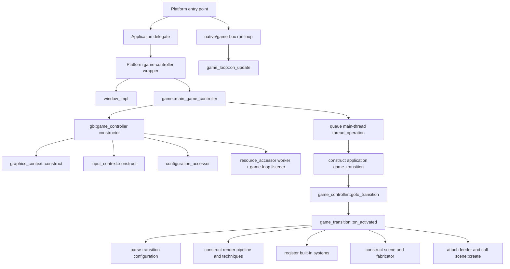

Windows uses `gbDemo/sources/main.cpp` -> `application_delegate_win32` -> `game_conroller_win32`; Apple uses `gbDemo/sources/main.m` and native app delegates. The Windows controller creates a 1280x720 `window_impl`. `main_game_controller::goto_island_demo_scene()` deliberately queues transition creation through a main-queue `thread_operation`, which is executed by `thread_operations_pool::update()` from the game loop.

Transition activation is the composition root for one running world. The default demo loads `transition.island_demo.xml`, builds render techniques, installs default system orders 0 through 7, registers the feeder with the game loop, constructs the scene, assigns feeder/root, and invokes `scene_graph::create()`.

## Frame update

```mermaid
sequenceDiagram
    participant Native as Native run loop
    participant Loop as game_loop
    participant Resources as resource_accessor
    participant Feeder as ces_systems_feeder
    participant Systems as ordered systems
    participant Jobs as thread_operations_pool

    Native->>Loop: on_update()
    Loop->>Loop: compute dt from steady_clock
    loop every unpaused listener in std::set order
        Loop->>Resources: on_update(dt)
        Resources->>Resources: commit waiting assets / callbacks
        Loop->>Feeder: on_update(dt)
        Feeder->>Feeder: apply queued entity membership changes
        Feeder->>Systems: all on_feed_start(dt)
        Feeder->>Systems: all on_feed(root, dt)
        Feeder->>Systems: all on_feed_end(dt)
        Feeder->>Systems: cleanup(root)
        Feeder->>Systems: cleanup_done(root)
    end
    Loop->>Jobs: update main-queue dependencies
    Loop->>Loop: update FPS counters
```

Important ordering caveat: game-loop listeners are held in `std::set<shared_ptr<i_game_loop>>`, so their order is pointer-owner ordering, not explicit semantic ordering. Within the ECS feeder, systems are explicitly sorted by their `ui8 order`, but execution is grouped by phase.

## Entity creation and scene attachment

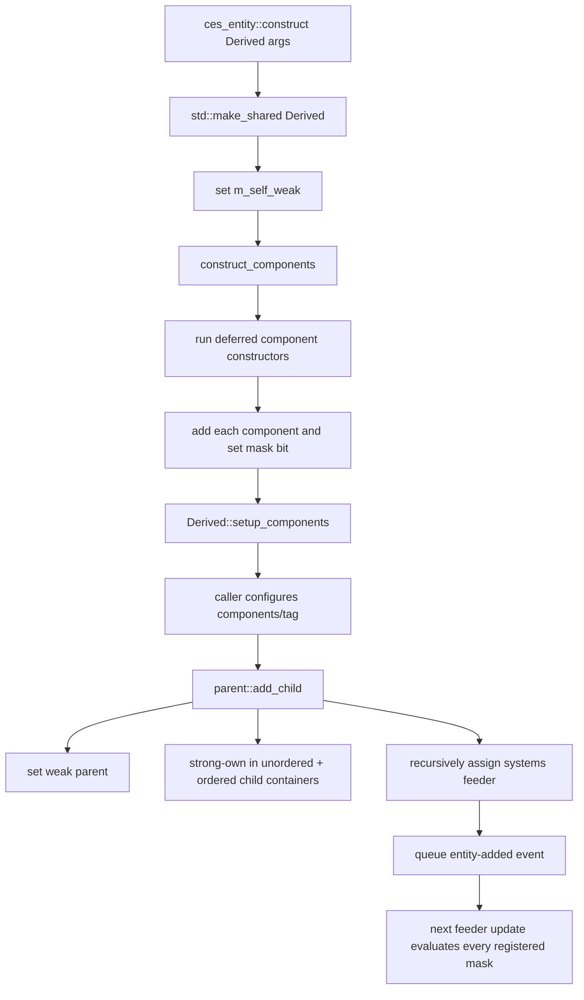

Canonical constructor behavior is in `gbCore/sources/ces_entity.h`. Derived entity constructors such as `game_object_3d` queue default transformation/geometry/material-related components using `add_deferred_component_constructor`. Calling `std::make_shared<Derived>` directly bypasses `m_self_weak`, deferred construction, and `setup_components()`.

## Component type registration and mutation

There is no explicit startup registry. Registration is lazy and process-local.

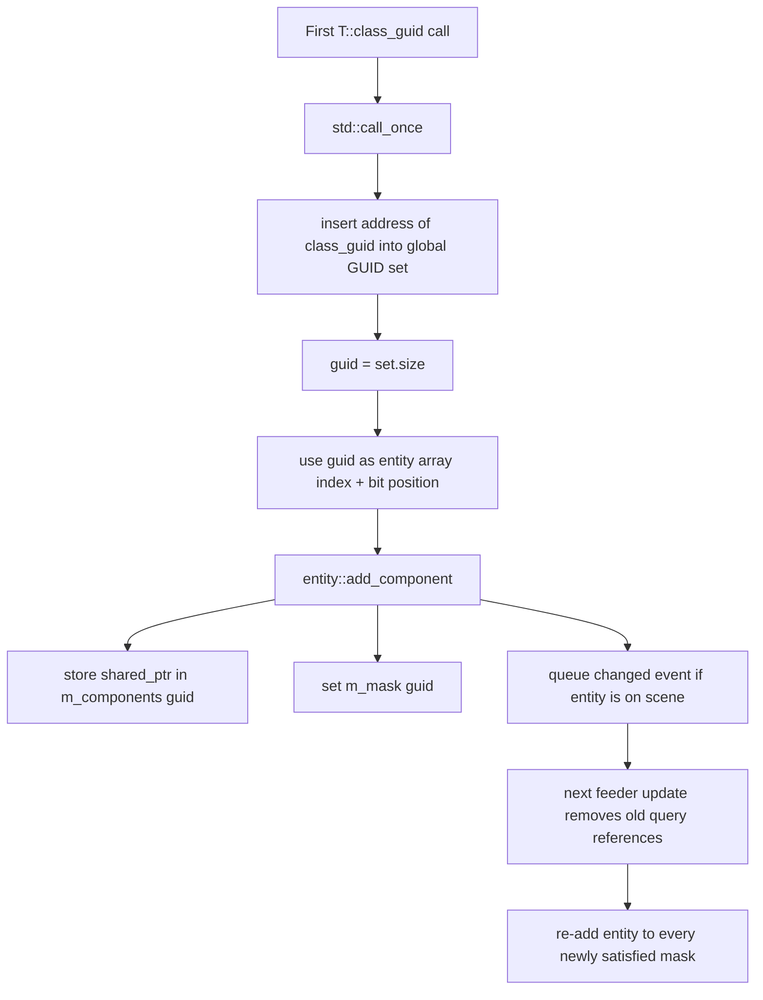

`STTI_CLASS_GUID` in `main_headers.h` supplies this behavior. Components and systems use separate static GUID sets because they pass `ces_base_component::g_guids_container` or `ces_base_system::g_guids_container`. IDs are not stable across processes or guaranteed across different first-use orders.

## System definition, registration, and update

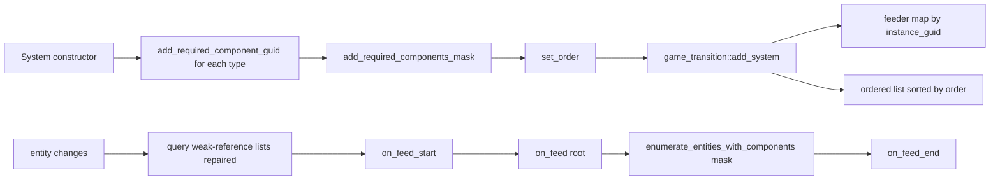

Registration examples occur in `game_transition::on_activated()` for core systems and scene `create()` implementations for application systems. A system can register multiple masks and enumerate each independently. `can_be_feeded()` also consults the root `ces_system_modifiers_component`, permitting per-system pause; the system's own `m_is_paused` flag exists but is not consulted by `ces_systems_feeder` in the inspected path.

## Mesh loading

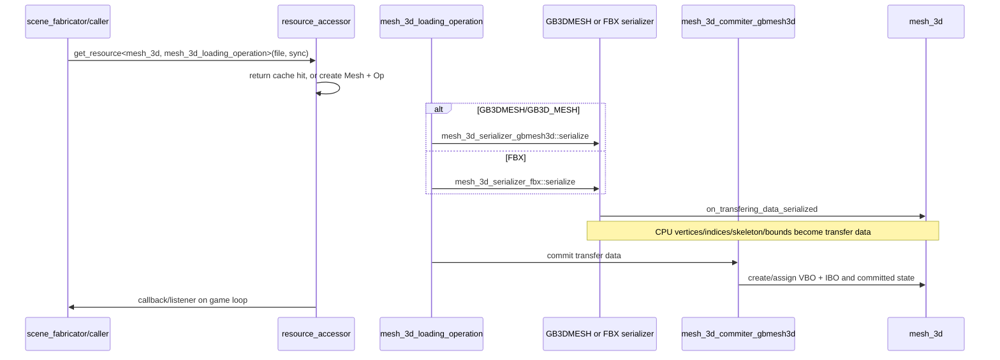

FBX support is routed through `mesh_3d_serializer_fbx.cpp` (ufbx) and then the same GB mesh committer. `scene_fabricator::create_shape_3d()` currently requests meshes synchronously (`sync=true`). File extension checks are string searches and partly case-specific.

## Texture loading

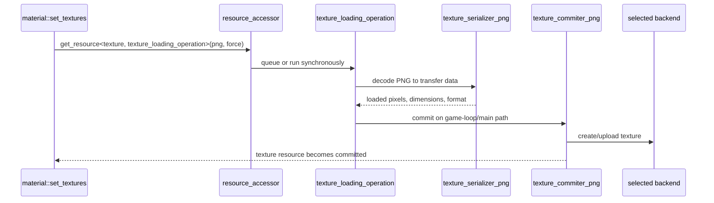

The loading operation contains an empty `.pvr` branch and asserts for other formats; PNG is the evidenced 2D texture path. Cubemaps have parallel `cubemap_texture_*_png` classes. Render-pass attachment textures bypass file loading and are registered with `resource_accessor::add_custom_resource()`.

## Shader creation

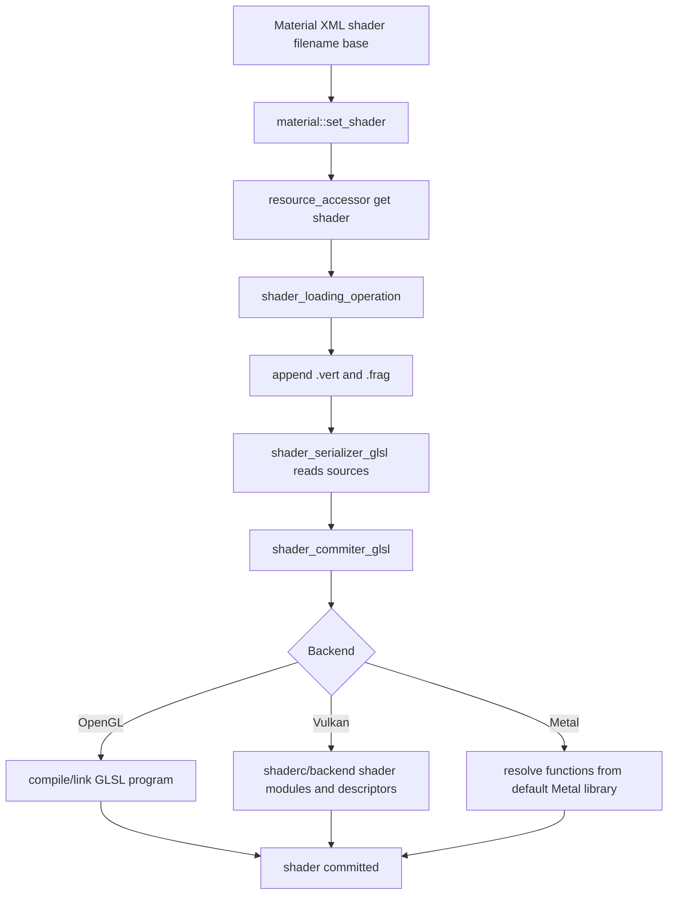

The base-name convention is visible in `shader_loading_operation.cpp`. Vulkan compilation and Metal symbol mapping contain backend-specific details in the shader/material implementation; adding only one GLSL file is insufficient because the loader always requests both stages.

## Material creation and attachment

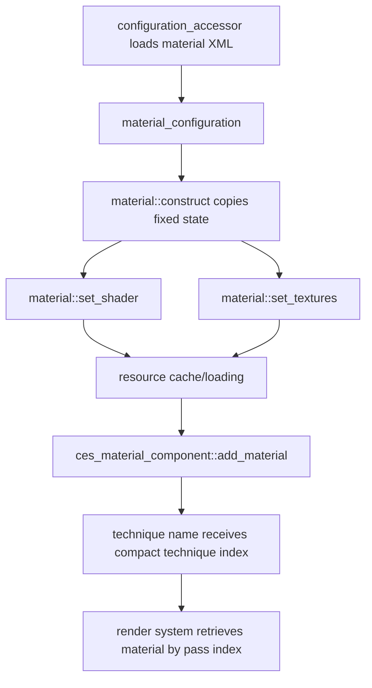

`scene_fabricator::add_materials()` is the normal integration point and forces synchronous resource loading. Transition screen-space/output materials use the same construction calls directly in `game_transition.cpp`.

## Render submission

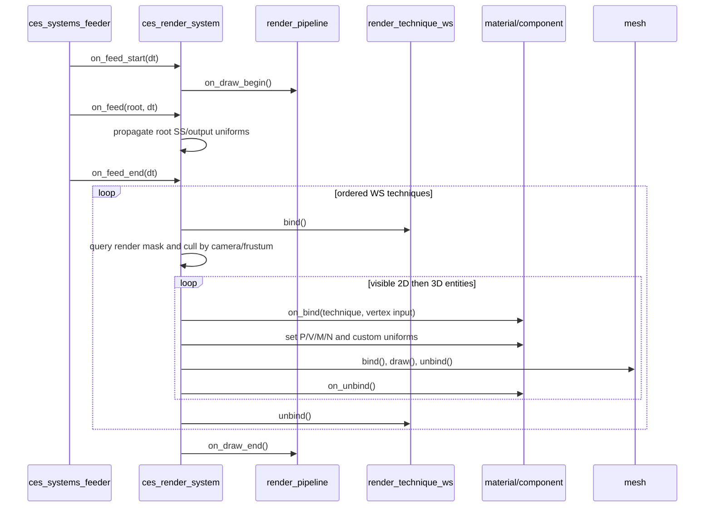

Renderable membership requires transformation, geometry, and material components. Visibility also requires both `visible` and `visible_in_next_frame`. 2D entities are ordered in `std::map<f32,...>` by z order; 3D entities use queues in the observed non-batching path. Technique selection is data-driven by material `technique_name` and pass GUID naming conventions.

## Render-pass execution

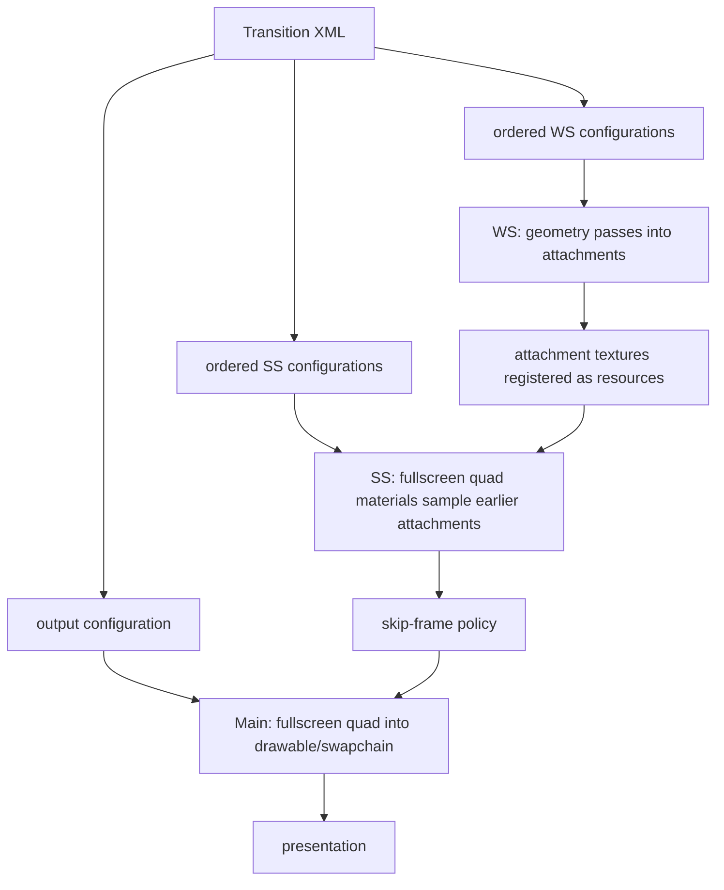

WS pass order comes from `ws_technique_configuration::order` and the importer. SS passes are drawn by `render_pipeline::on_draw_end()` in their configured ordered list. `render_technique_ss` and `render_technique_main` draw screen quads. OpenGL constructs FBOs directly; Vulkan and Metal use the common `render_pass_descriptor` facade.

## GPU presentation

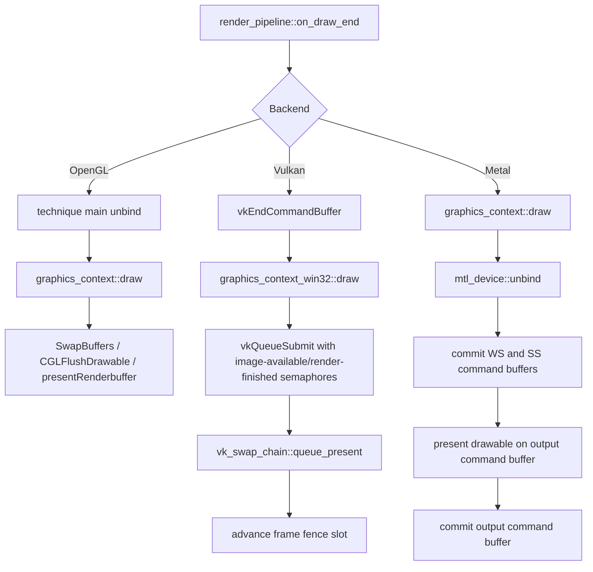

For Vulkan, image acquisition happens earlier in `graphics_context_win32::make_current()`. For Metal, three command buffers are created in `mtl_device` frame bind and committed in a fixed WS -> SS -> output order, guarded by dispatch semaphores.

## Configured scene/level loading

The term “scene” has two paths in this repository:

1. Runtime application scenes (`scene_graph` subclasses) are created by transitions and usually assemble entities procedurally through fabricators.
2. Asset scenes (`scene_2d` TMX and `scene_3d` GB3DSCENE resources) are loaded through the resource pipeline and consumed by fabricators.

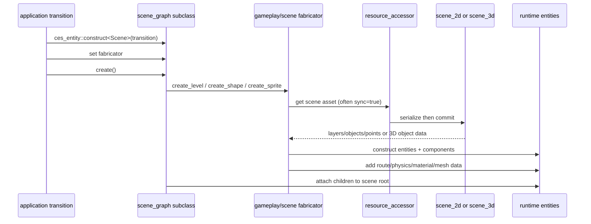

`gameplay_fabricator::create_level()` is the strongest current 2D scene-loading example: it loads a TMX `scene_2d`, interprets named object groups such as `route`, creates 3D track/building/gameplay entities, and builds Box2D data. This is application-specific interpretation, not a generic automatic TMX-to-ECS world instantiator.

## Transition change and shutdown

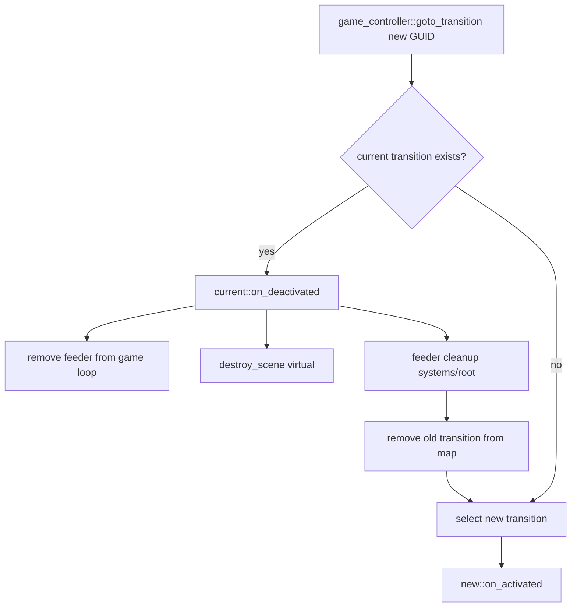

The `game_controller` destructor clears transitions, and the `resource_accessor` destructor stops/joins its worker. Exact application shutdown ordering across native delegates, static graphics singletons, the job-pool singleton, audio, and network threads is `UNKNOWN`; investigate those destructors before adding shutdown-sensitive work.

## Island ocean frame

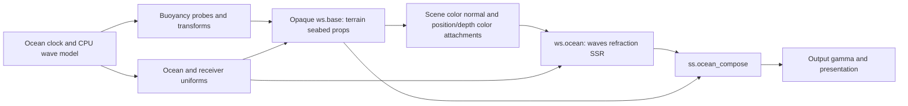

Water samples separate scene-data color attachments, never the pooled active
hardware depth attachment. Empty scene position/depth has zero alpha; valid
geometry has positive linear view depth. CPU and shader sampling share a direct static-XZ domain-warped height field.
Geometry mask, seed/JFA/resolve and raised foam are configured WS stages before
composition; their field is independent of the player camera. The ocean system
clamps simulation time to 0.25 s per frame and updates uniforms after buoyancy.
