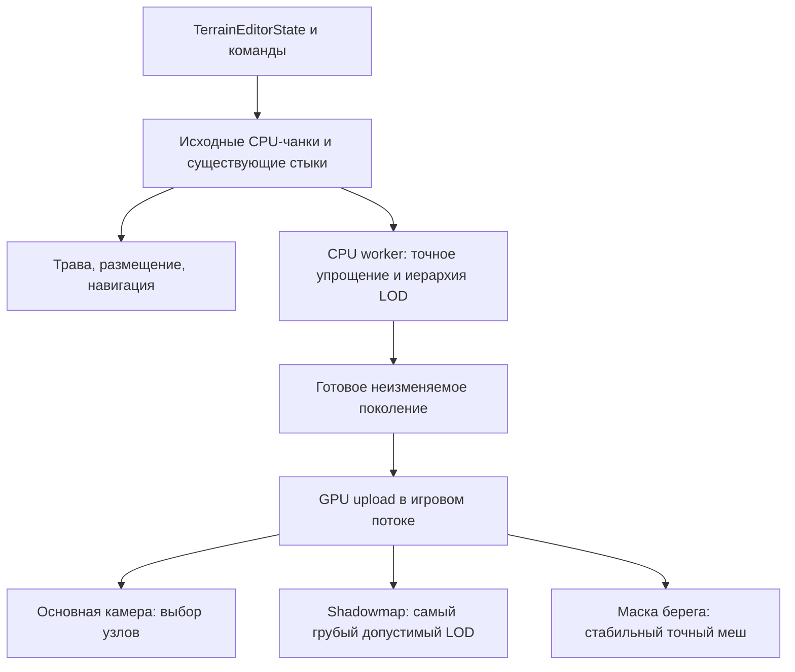

# Точное упрощение террас и Continuous LOD

Дата: 2026-10-16. Статус: проект утверждён пользователем, реализация не начата.
Основание: [замеры и аудит](../../terrain-geometry-audit.md).

## Согласованные требования

- Проектировать одновременно точное упрощение Terrain-мешей и Continuous LOD.
- По умолчанию контуры террас сохранять **строго**, включая дальние участки.
  Последующее уточнение пользователя: отдельный слайдер разрешает упрощение
  дальних контуров на 0–50%; ближайший LOD всегда имеет 0%.
- Сохранить восемь надводных террас, их плоскости, высоты, сглаженные контуры,
  вертикальные уступы, материалы, текстуры и положение берега.
- Не менять траву, деревья, здания, лестницы, логику редактора, размещение объектов,
  навигацию, undo/redo или формат файлов уровня.
- В обоих проходах shadowmap использовать самый грубый доступный допустимый LOD
  независимо от основной камеры.
- Добавить количество LOD справа от времени суток и процент упрощения справа
  от вращения скайбокса. Подтверждено: количество включает ближайший LOD.
- Сравнить кадры и измерить результат. Снижение числа треугольников не считать
  доказательством такого же роста FPS.

## Что именно означает Continuous LOD при этих ограничениях

Система имеет иерархию пространственных узлов, несколько подготовленных
представлений, непрерывную функцию выбора детализации по параметрам камеры и
согласованные переходы соседей. Это адаптация идеи CLOD к отдельным плоским
террасам и вертикальным стенам, а не перенос обычного CDLOD-heightfield.

При упрощении контура 0% уровни меняют только внутреннюю триангуляцию площадок.
Все реальные контурные сегменты, отверстия и стены остаются в каждом представлении.
При значении выше 0% разрешено согласованно сокращать контур и перестраивать
прилегающие площадки и стены по правилам следующего раздела. Топология террас
и дискретные высоты не меняются.

При P=0 геометрическая ошибка плоской площадки равна нулю. Её самый
редкий допустимый вариант выгоден и вблизи, и вдали. Система выбирает его сразу,
а не искусственно оставляет рядом с камерой плотную сетку. Если варианты дают
одинаковые затраты и поверхность, дубли уровней не создаются.

Обычный morphing высот через уступы запрещён. Для эквивалентных плоских
триангуляций переход может менять индексы без движения видимой поверхности;
двойная отрисовка с прозрачностью, dithering и добавление скрывающих щели юбок
не нужны. Если вариант нельзя переключить с сохранением покрытия и общих рёбер,
он не участвует в выборе. При 0% такой CLOD не обещает уменьшить неизменяемые
стены или опуститься ниже количества полигонов, необходимого для точного контура.
При значении выше 0% нужен дополнительный непрерывный переход согласованного
контура; резкая подмена одного силуэта другим недопустима.

## Новые контролы и смысл процента

Верхняя панель становится двухколоночной:

| Слева, существующий контрол | Справа, новый контрол |
|---|---|
| Time of day | Terrain LODs |
| Skybox rotation | Contour simplification |

Использовать тот же полупрозрачный фон, шрифт, подписи, ползунки и цвета, что
в существующей панели. Пересчитать масштаб верхнего toolbar и положение Saved/
Modified, чтобы новые контролы не перекрыли статистику или правую панель.
Hit-test и перехват ввода должны учитывать расширенную панель.

- Предлагаемый рабочий диапазон количества: **1–8**, целые значения; начальное
  значение **5**. Это число вариантов детализации, а не число уровней quadtree.
  Глубина пространственного дерева независимо определяется размером мира.
- Упрощение: **0–50%**, начальное значение **0%**, шаг UI 1 процентный пункт.
  Промежуточные LOD получают дробные проценты без округления до шага UI.
- `N` включает ближайший уровень `i=0` и самый дальний `i=N-1`.
- Максимум `P` — сокращение числа контурных сегментов относительно ближайшего
  LOD, а не доля смещения координат, площади, высоты или всех треугольников.
- Для `N>1`: `simplification(i) = P * i / (N-1)`.
- Для `N=1`: единственный LOD имеет 0%. Контрол процента временно неактивен;
  сохранённое предпочтение P восстанавливает действие после увеличения N.

Подтверждённый пользователем пример:

| LOD от ближайшего к дальнему | 0 | 1 | 2 | 3 | 4 |
|---|---:|---:|---:|---:|---:|
| При N=5 и P=50% | 0% | 12,5% | 25% | 37,5% | 50% |

Процент каждого LOD считается **от исходного ближайшего**, не последовательно
от уже упрощённого предыдущего. Для контура с 320 сегментами примерные целевые
числа — 320 / 280 / 240 / 200 / 160. Для коротких контуров целевое количество
округляется к большему целому; замкнутый контур не может стать меньше треугольника.

Безопасность важнее достижения процента: фиксированные стыки и опоры могут не
позволить удалить столько сегментов. Фактическое сокращение выводится в F8
отдельно от запрошенного. Недостижимый процент не обходится перемещением
закреплённых вершин или появлением отверстий.

UI меняет общие настройки Terrain LOD через состояние/команды настроек и не
вызывает генератор или mesh builder напрямую. Настройки независимы от данных
уровня и undo/redo его геометрии. Предлагаемый `TerrainLodSettings` содержит
`lodCount`, `contourSimplificationPercent` и ревизию предпочтений.

Оба значения сохраняются существующей кнопкой Save в F8 в новом объекте
`terrainLOD` файла `gbResources/GraphicsSettings.json` и загружаются при запуске.
Существующая кнопка Save уровня сохраняет уровень, её смысл не меняется.
Отсутствующие поля старых GraphicsSettings получают defaults 5 и 0%; загрузка
валидирует типы и диапазоны до применения, не меняя другие настройки частично.

Изменение значений действует в реальном времени, через асинхронную подготовку
render-данных. События перетаскивания объединяются; приоритет имеет последняя
ревизия настроек. Пока она готовится, используется предыдущий валидный набор.
TerrainData, CPU-чанки, трава и навигация из-за движения этих ползунков не
перестраиваются. Нельзя оставлять UI-контрол, который сохраняет число, но не
влияет на фактически выбираемые варианты геометрии.

## Управляемое упрощение контура при P больше нуля

Генерировать вложенную последовательность удалений контурных вершин один раз
из ближайшего LOD. Дальние варианты используют префиксы этой последовательности
по целевым процентам. Сохранять отдельные замкнутые компоненты и отверстия;
запрещены самопересечения, слияние террас, изменение порядка уровней и появление
площадки на уровне воды.

Общая граница верхней площадки, прилегающей стены и нижней площадки должна
использовать одну версию контура. Верх и низ вертикальной стены движутся по XZ
согласованно, без изменения Y. Стена перестраивается по новому контуру с
согласованными нормалями; усреднять её нормаль с горизонтальной площадкой нельзя.

Закреплять внешние стыки узлов и точки перехода к неупрощаемой геометрии.
Также сохранять опоры лестниц и безопасную площадь существующих зданий и
деревьев. Упрощение не должно создавать видимые висящие корни травы или стволы;
если участок не проходит проверку, для него выбирается более подробный вариант.
Данные размещения и сами объекты при этом не сдвигаются.

Непрерывный переход выполняется по подготовленным соответствиям вершин в XZ.
Промежуточные положения обязаны сохранять вложенность и отсутствие пересечений;
проверяется весь интервал перехода. Невалидная операция исключается из
последовательности. Стыки соседей используют одинаковый коэффициент перехода.
Менять два силуэта прозрачным crossfade или маскировать щель юбкой нельзя.

GPU-переход требует данных целевого положения и параметров morphing у Terrain.
Это добавленная часть проекта: необходимо согласованное изменение GLSL и Metal
вариантов, не затрагивающее vertex bending травы и деревьев. Конкретная упаковка
атрибутов и uniform bindings проверяется по действующим PTNTC и material-путям
при составлении плана; новое API или свободный shader slot не предполагаются.

## Архитектура и владение

Реализация остаётся в `gbDemo`, поскольку представляет террасный ландшафт этой
сцены. Общие `ces_render_system`, `render_pipeline`, `ces_entity` и backend-native
классы для этого не меняются. Используются имеющиеся shape/material/mesh/ibo/vbo.

Предлагаемые новые модули, **не существующие API движка**:

| Модуль | Ответственность |
|---|---|
| `terrain_mesh_optimizer.h/.cpp` | CPU-индексирование, выделение плоских областей, упрощение с фиксированными границами, проверка результата |
| `terrain_lod.h/.cpp` | CPU-иерархия, границы узлов, поколения, сведения о стыках и выбор представлений без GPU-зависимостей |
| `terrain_lod_renderer.h/.cpp` | Владение shape/GPU-мешами трёх потребителей, публикация поколения, переключение подготовленных представлений |

Интеграция: `TerrainEditorRenderCache`, `island_demo_scene`, существующие
`ces_sun_shadow_system` и `ces_ocean_system`, `terrain_editor_ui` и
`graphics_settings`, а также Terrain-шейдеры GLSL/Metal для morphing при P>0.
Точные сигнатуры добавлений
фиксируются в плане реализации после одобрения этого проекта. Новые файлы
добавляются в Windows `.vcxproj` и применимые Xcode targets; C++14 в Windows,
совместимость с используемым Apple C++11 сохраняется.

## Точное упрощение

1. Собирать Terrain-геометрию из тех же CPU-чанков и стыков, что используются
   сейчас. Seed-геометрия и геометрия после редактирования не заменяют друг друга
   вне действующих remeshing policies.
2. Объединять вершины только при точном совпадении всех значимых атрибутов.
   Нельзя сваривать вершины только по позиции или округлять контуры.
3. Выделять связные горизонтальные области одной высоты, нормали, outline ID и
   совместимых атрибутов. В первой реализации упрощать только постоянные
   атрибуты; градиенты оставлять исходными. Не предполагать, что неиспользуемый
   сегодня UV можно бесконтрольно удалить из данных.
4. Зафиксировать внешний периметр, отверстия, материальные границы, рёбра стен,
   стыки с исходными чанками и граничные вершины соседних LOD-узлов.
5. Убирать внутренние вершины повторной триангуляцией области. Операция должна
   сохранять ориентирование, покрытие, отверстия и фиксированные сегменты.
   Некорректная/неоднозначная область сохраняет исходные треугольники целиком.
6. В точной базовой геометрии все стены, включая существующие соединения
   seed/editor, переносить без изменения треугольников и атрибутов. При P>0
   дальние варианты перестраивают только стены изменённого контура по правилам
   согласованного упрощения; ближайший и вариант P=0 сохраняют оригинал.
7. Удалять неиспользуемые вершины, разбивать GPU-пакеты с учётом 16-битных
   индексов и существующего безопасного ограничения 60 000 вершин на пакет.

Для каждого результата хранить исходные и итоговые vertex/triangle counts,
количество сохранённых областей и причину отказа упрощения. Оценка аудита
621 302 → 232 526 относится к полностью сеточному острову и не является
обещанием итогового количества.

## Пространственная иерархия и стыки

- Лист соответствует существующему чанку 16 × 16 ячеек. Размер в метрах
  вычисляется из конфига, не захардкожен как 32 м.
- Родитель охватывает 2 × 2 дочерних узла. Для разрешений, не кратных степени
  двойки, дерево дополняется пустой областью без генерации поверхности.
- AABB вычисляется по фактическим вершинам, включая стены, существующие
  стыки, все варианты контура и их morphing. Пустой узел не получает GPU-пакет.
- Точный базовый меш родителя представляет объединение поверхности потомков;
  его дальние варианты при P>0 подчиняются общей последовательности контура.
  Внутренние границы чанков могут исчезнуть только там, где это не реальный
  уступ и не граница атрибутов. Настоящие стены никогда не растворяются при merge.
- У всех уровней внешний периметр фиксируется по единому набору граничных
  сегментов исходных листьев. Более грубый узел обязан сохранить необходимые
  коллинеарные точки периметра. Это консервативно, зато сосед с другим LOD
  получает буквально те же рёбра и не создаёт T-junctions.
- Соседние выбранные узлы не должны отличаться более чем на один уровень.
  Балансировка только уточняет выбор, не меняя координаты геометрии.
- Для одного пространственного участка выбирается родитель **или** его
  потомки. Одновременного покрытия одной площадки двумя уровнями нет.

При публикации разные поколения соседей не смешиваются на шве: новая версия
должна иметь совместимый внешний периметр с остающимися соседями. Если периметр
изменился при редактировании, согласованно публикуется минимальная группа
затронутых соседей; до её готовности остаётся целиком предыдущая версия.

## Выбор для основной камеры

Выбор использует фактические view/projection и viewport; расстояние берётся
до AABB, а не только до центра узла. Перед выбором проверяется frustum.

Непрерывная величина ошибки в пикселях:

`screen_error = world_error * projection_scale / max(distance_to_bounds, epsilon)`

`projection_scale` выводится из матрицы проекции и высоты viewport. При P=0
`world_error` равен нулю: плоскости и контуры точны. Кандидат с ненулевым
изменением формы при P=0 отклоняется независимо от удаления от камеры.

При P>0 хранить измеренное максимальное отклонение каждого варианта от
ближайшего. Выбор по расстоянию и экранной ошибке использует подготовленные
N вариантов. Начальный внутренний ориентир качества — не более одного пикселя
экранной ошибки; это параметр алгоритма, а не трактовка пользовательского
процента. При невыполнении ориентира используется более подробный вариант.
Непрерывный коэффициент перехода определяется теми же расстояниями у соседей.
Ближайшая зона всегда выбирает LOD0 с 0%; дальняя может достигать LOD N-1
с запрошенным P, когда соблюдены ограничения. При P>0 запрещено выбирать
упрощённый контур вблизи только потому, что площадка горизонтальная.

Число N не ограничивает глубину quadtree. Пространственное укрупнение точных
плоских областей остаётся допустимым вблизи: оно не означает применение к ним
упрощённого силуэта дальнего LOD.

Из допустимых выбирается вариант с меньшей измеренной стоимостью: число
треугольников и пакетов. Родитель не обязан выигрывать, если пересекает frustum
и заставляет отрисовывать слишком большую невидимую область. У полностью
видимых плоских областей укрупнение обычно выгоднее. Балансировка соседей и
проверка доступности подготовленных мешей выполняются после первичного выбора.

Выбор запускается при изменении камеры/viewport/поколения. Переключение имеет
гистерезис по критерию стоимости, чтобы камера у границы не вызывала постоянную
смену одинаковых по качеству пакетов. Оно не запускает CPU-триангуляцию,
генерацию травы или навигацию и не загружает заново уже подготовленные VBO.

## Независимые shadowmap и маска берега

### Shadowmap

`ws.sun.near` и `ws.sun.far` получают самый грубый **подготовленный и проверенный**
Terrain-LOD. Они не наследуют выбор основной камеры или её список видимых
узлов. Отсечение выполняется отдельно в пространстве каждой карты теней.
При P=0 контур тени сохраняется точно. При P>0 проверка допустимости грубого
контура учитывает проекцию света; ориентир — не более одного texel shadowmap
отклонения. Если самый дальний вариант не проходит проверку, используется
самый грубый из проходящих, без изменения bias или фильтрации для маскировки ошибки.

Рендер-контроллер передаёт sun-shadow-системе отдельный набор Terrain-caster
мешей с transform, bounds и generation. Для этих террас автоматическое создание
прокси по мешам `ws.base` отключается, чтобы не возникли двойные тени. Существующий
путь зданий, персонажей и деревьев продолжает работать; при появлении у них
собственных LOD применяется самый грубый допустимый вариант, а пока — исходный.

Нельзя терять внекамерные caster-объекты, менять skinning, матрицы света, bias,
alpha-cutout или фильтрацию. Если грубый меш ещё не готов, используется последняя
валидная версия того же поколения или более подробный валидный вариант.

### Маска берега

`ws.water.mask` получает стабильную геометрически точную поверхность поколения,
не зависящую от камеры. Допустим самый грубый вариант с неизменными контурами,
но он проверяется в проекции water interaction и сохраняет покрытие над водой.
Для этой маски процент упрощения контура всегда 0%, даже если в UI P>0;
оптимизация внутреннего разбиения площадок разрешена. Визуальный LOD при этом
проходит проверку согласованности с точным берегом в текущей проекции: если
разница открывает видимый разрыв с пеной, выбирается более подробный вариант.

Нынешнее автоматическое копирование меша/видимости основной сущности через
`ces_ocean_system::add_interaction` для этих Terrain-мешей заменяется отдельной
регистрацией устойчивых источников маски. Скрытие визуального LOD-узла или выбор
его родителя не должно скрывать берег. Остальные океанские объекты продолжают
использовать прежний путь взаимодействия.

## Редактирование, потоки и ресурсы

- Источник истины — `TerrainEditorState` и логические CPU-чанки. Их не заменяет
  выбранный камерой render mesh.
- Grass roots, их порядок и seed остаются производными прежних поверхностей.
  Трава не генерируется заново из изменённой триангуляции для рендера.
- Dirty region расширяется существующим halo. Перестраиваются затронутые листья,
  нужные для совместимости соседи и предки этих узлов. Другие ветви сохраняются.
- CPU-оптимизация и построение LOD выполняются существующим worker-механизмом
  на snapshot уровня. Результат имеет load generation, revision и версии листьев.
  Устаревший результат не заменяет более новый, включая родительские узлы.
  Ключ результата также содержит ревизию N/P: устаревшие настройки не могут
  перезаписать последнее положение слайдеров. Смена N/P не запускает навигацию.
- GPU upload и callback остаются в игровом потоке. Полностью готовые совместимые
  наборы публикуются атомарно; до этого показывается предыдущая версия.
- Общая геометрия по возможности разделяет immutable VBO между вариантами
  индексов. Если состав вершин отличается, используется отдельный меш.
- Замена освобождает старые ресурсы существующим безопасным путём с учётом
  кадров в работе. CLOD не меняет Vulkan/Metal presentation или синхронизацию.
- Родительские варианты создаются по бюджету и переиспользуются. Геометрически
  и топологически одинаковые варианты не хранятся повторно. Опциональный LOD,
  который не экономит треугольники/пакеты, не загружается.
- Базовая корректная геометрия и активные наборы всегда остаются доступны.
  Исчерпание бюджета дополнительных LOD приводит к выбору подготовленного более
  подробного варианта, а не к исчезновению участка или синхронной генерации.
  Пиковую память и стоимость предков необходимо измерить до включения по умолчанию.

## Диагностика и критерии приёмки

В F8 у существующих проходов сохраняются настоящие submitted triangle counts.
Дополнительная диагностика Terrain показывает исходные/оптимизированные числа,
выбранные узлы по уровням, culled nodes, CPU-время выбора, rebuild/upload и
память LOD. Она должна объяснять, когда доступны только одноуровневые варианты.

Обязательные проверки:

1. При P=0 ровный чанк 16 × 16: 512 → не более 62 треугольников при сохранении всех
   64 граничных вершин. Все исходные контурные и стыковочные сегменты сохранены.
2. Площади, покрытия, высоты, отверстия, нормали, outline ID, ориентирование и
   материальные швы совпадают. Проверены разорванные области, отверстия,
   острые углы, несколько seed и крайние редактируемые высоты.
3. Смешанные уровни соседей, граница seed/editor и частично готовые поколения
   не дают щелей, наложений и новых стен. Ошибочный результат вызывает fallback.
4. Grass roots/параметры идентичны. Размещение зданий и лестниц, пути персонажей,
   undo/redo и save/load не зависят от положения камеры и выбранного LOD.
5. Shadowmap обоих масштабов использует свой грубый допустимый набор; нет двойных
   теней или пропавших внекамерных caster-объектов. При P=0 силуэты неизменны;
   при P>0 соблюдён критерий проекции света, включая низкое солнце.
6. Маска берега и пена не меняются при выборе LOD, повороте или отдалении камеры.
7. Переходы камеры не запускают terrain rebuild/navigation и не вызывают GPU
   upload подготовленных вариантов. Время выбора проверяется отдельно от worker.
8. Повторён CPU-аудит начального острова, одиночного штампа и полностью сеточного
   острова. Фактическое сокращение сравнивается с исходными числами без подмены
   сценария. Измеряются draw calls и память; фиксированного обещания FPS нет.
9. Кадры до/после сняты с одинаковыми камерой, временем суток, волнами и ветром:
   общий вид, близкий план, скользящий угол, берег, здания, тени, пена. Форма и
   материалы должны совпадать; отличия из-за интерполяции исследуются, а не
   объявляются автоматически допустимыми. При P=0 изменение контура неприемлемо;
   при P>0 ближайший LOD точен, дальние соответствуют целевым процентам с учётом
   явно зарегистрированных ограничений. Переход не меняет высоты и топологию.
10. Проверены сборка и запуск Vulkan с validation. OpenGL и Metal требуют
    отдельных проверок; успех Windows не означает их проверенность.
11. Ползунки расположены в нужных строках без перекрытий на поддерживаемых размерах
    окна. Проверены N=1, N=5, P=0, P=50, быстрый drag и пример
    0 / 12,5 / 25 / 37,5 / 50%. Доля удалений не считается накопительно.
12. Save в F8 и перезапуск восстанавливают оба значения. Старый GraphicsSettings
    получает defaults; неверный тип, NaN и выход из диапазона не применяются
    частично. Сохранение уровня и его undo/redo от графических настроек независимы.

## Порядок реализации в рамках одного проекта

1. Точное упрощение и CPU-проверки, сравнение кадров и повторный аудит.
2. Иерархия, совместимые варианты и выбор CLOD, проверка переходов и памяти.
3. Опциональное упрощение контура, непрерывный XZ-morphing и GLSL/Metal-паритет.
4. Независимые Terrain-shadow-caster и точная water-mask.
5. Слайдеры, GraphicsSettings, региональная публикация, диагностика F8 и проверка редактора.

Все этапы входят в проект сейчас. Это порядок зависимостей, а не отсрочка
решения о наличии CLOD. Точный режим P=0 и ближайший LOD нельзя ослаблять ради
производительности. При P>0 упрощение разрешено только в пределах изложенных
правил; компенсировать ошибки туманом, blur либо смещением воды нельзя.
