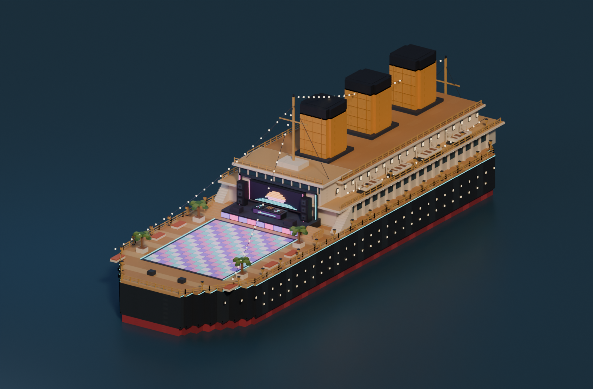

# Rhythm Party Liner

Редактируемый игровой лайнер по согласованному воксельному референсу. Исходник:
[rhythm_party_liner.bbmodel](../rhythm_party_liner.bbmodel), формат Blockbench **Free Model**.
Создан и повторно открыт в **Blockbench 5.2.2**. Текстура встроена в проект;
внешняя копия — [palette.png](palette.png), 128×128.



## Состав

Чёрный ступенчатый корпус с красной нижней полосой, белые надстройки и мостик,
три охристые трубы с тёмными колпаками, восемь шлюпок, ограждения, мачты,
гирлянды, фонари и пальмы. Кормовая зона включает танцпол, сцену, лестницы,
экран с пиксельным закатом, две группы колонок и отдельный DJ-пульт с двумя
проигрывателями, микшером и кнопками.

- **2 290 кубоидов, 27 480 треугольников, 34 группы.** Счёт включает скрытые грани;
  это исходная редактируемая геометрия, без оптимизации при экспорте.
- `hull`, `decks`, `superstructure`, `funnels`, `lifeboats`, `railings`, `lamps`,
  `dance_floor`, `stage`, `dj_console`, `speakers`, `screen`, `stairs`, `props`.
- В `emissive_surfaces` находятся `warm_windows`, `festoon_bulbs`, `dance_tiles`,
  `stage_neon`, `console_leds`. Их можно назначать разным игровым материалам.
  Светлые цвета сами по себе не создают освещение в движке.

## Размеры и будущее подключение к игре

Одна единица Blockbench соответствует одной планируемой мировой единице.
Ось Y направлена вверх; сцена расположена со стороны отрицательного Z.

| Область | Координаты модели |
|---|---|
| Общие габариты | около 62,6 × 66,6 × 210,32 по X/Y/Z, с мачтами и ограждениями |
| Основная палуба | Y = 3,55 |
| Поверхность танцпола | Y = 3,86 |
| Свободный танцпол | X = −18…18, Z = −20…28 |
| Сцена | X = −18…18, Z = −38…−24, верх Y = 6,55 |
| Центр DJ-пульта | примерно X = 0, Z = −30 |
| Вода на рендер-превью | Y = −13,5, чтобы показать красную полосу |

Текущая игровая расстановка толпы помещается на танцполе по X/Z. При подключении
нужно поднять персонажей на новую поверхность и согласовать вертикальное
положение всего корабля с океаном. Например, при воде движка Y = 0 и выборе
ватерлинии модели Y = −13,5 корабль и его игровые якоря получают общее смещение
Y = +13,5. Это ещё не выполнено; текущая сцена, камера, океан и skybox не изменены.

## Превью

- [Общий вид](overview.png)
- [Танцпалуба и сцена](party-deck.png)
- [DJ-пульт крупно](dj-console.png)
- [Настоящий viewport Blockbench](blockbench-view.png)

Рендеры получены из сохранённого `.bbmodel`. Солнце, заполняющие источники и синяя
плоскость воды — только окружение для просмотра; их нет в исходнике. Это не
скриншоты из игры. Ни FBX, ни игровые материалы на данном этапе не подключались.

## Воспроизведение и проверки

Для авторинга нужен установленный Blockbench, Node ≥18 и отдельный профиль:

```powershell
# Запускать с отдельным профилем; не использовать порт пользовательского редактора.
Start-Process 'C:/Program Files/Blockbench/Blockbench.exe' -WindowStyle Hidden -ArgumentList '--userData','C:/Hobby/game-box/gbDemo/output/rhythm-check/party-liner/native-profile','--remote-debugging-port=9242','--disable-gpu','--no-sandbox'
node gbScripts/invoke-party-liner.mjs author
node gbScripts/invoke-party-liner.mjs reload
node gbScripts/invoke-party-liner.mjs viewport
```

Эти команды пересоздают **только этот** исходник, палитру и отчёты. Не запускайте
их после ручной правки `.bbmodel`, если хотите сохранить ручные изменения.
В изолированном экземпляре авторинг создаёт новый проект, не перезаписывая другие
открытые проекты. `--disable-gpu` нужен только для данного фонового экземпляра.

```powershell
& 'C:/Program Files/Blender Foundation/Blender 5.2/blender.exe' --background --python-exit-code 1 --python gbScripts/render-party-liner.py -- .
# Быстрая геометрическая проверка без рендеров:
& 'C:/Program Files/Blender Foundation/Blender 5.2/blender.exe' --background --python-exit-code 1 --python gbScripts/render-party-liner.py -- . --validate-only
```

[authoring-report.json](authoring-report.json) содержит нативные габариты и состав;
[reload-report.json](reload-report.json) — результат повторного открытия;
[validation.json](validation.json) — SHA-256 исходника и геометрические проверки.
Проверяются текстура, уникальность и принадлежность объектов, конечность координат,
нормали/UV, совпадение габаритов с Blockbench, число треугольников, свободное место
для персонажей и соединение верхних ступеней со сценой. Проверка ступеней сначала
воспроизвела зазор 1,8 единицы, затем прошла после исправления геометрии.

Поскольку игровые исходники и сборочные проекты не менялись, сборка движка и
проверка Vulkan/Metal/OpenGL не выполнялись для этого ассета.
